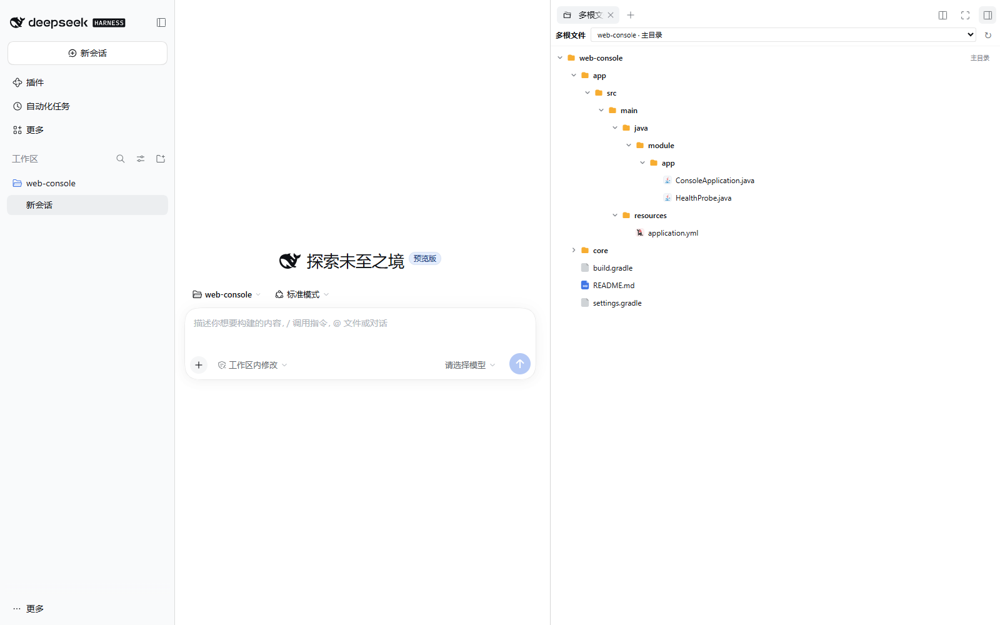
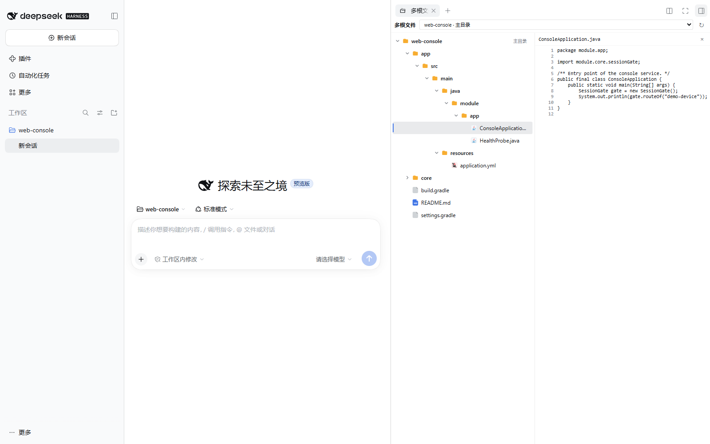
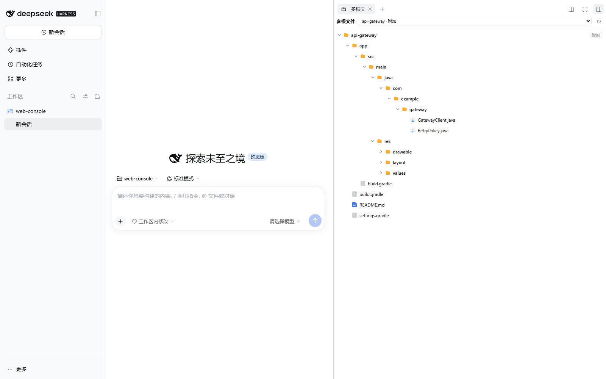
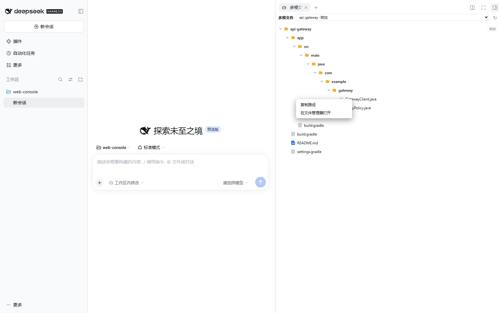

# dsh-multi-root-files

右侧栏的多根文件树：同时列出**会话主目录**与 multi-root-workspace 登记的**每个附加工作区根**，
点击文件直接在右侧侧栏的编辑器标签里打开（不新开窗口、不调用外部程序）；
**右键任何行**还能复制绝对路径、在系统文件管理器里打开。

DSH 自带的「文件」面板只从会话主目录向下扫描，附加根里的代码在面板里根本看不见。
这个插件补上那一层：根列表由宿主侧路由从多根登记表读出，目录内容仍走 better-sidebar
现成的 `fs.trees` 路由（工作区围栏已移除，绝对路径在 cwd 之外也能列）。



## 它解决什么问题

很多项目的实际结构是**若干个平级仓库**：

```text
D:\dev\demo-platform\
  web-console\      ← 会话主目录
  api-gateway\      ← 同级，附加工作区根
  shared-i18n\      ← 同级，附加工作区根
```

`api-gateway`、`shared-i18n` 都不在 `web-console` 下面，所以自带面板永远扫描不到它们 ——
哪怕你已经用 `@dsh-electron/dsh-plugin-multi-root-workspace` 把它们登记成了附加根，
Agent 能读写它们，**但你仍然只能在面板里看到主目录的文件**。

本插件把根列表换成「主目录 + 全部附加根」，一个页签里切换查看。

## 功能

- **根列表**：工具栏的下拉框列出全部根——主目录排第一（标记「主目录」），附加根按登记顺序
  跟上（标记「附加」）。选中哪个根，树就显示哪个根。
- **目录懒加载**：展开目录时按批请求 `fs.trees`（每次 ≤64 个路径），单层失败只在该层显示
  「这个目录读取失败」，不会让整个面板报错。
- **左右分栏**：点文件时，树在左、文件内容在右并排显示（不是上下堆叠），
  这样在侧栏这种窄列里文件树仍然可读。

  

- **附加根一样能用**：切到附加根，目录树照常展开——附加根的代码不用切窗口就能看。

  

- **Git 状态标记**：已修改 / 未跟踪 / 忽略的文件在树里带标记，目录本身也会标出「里面改了东西」。
- **右键菜单**：文件行、目录行、根标题、预览标题都支持右键，两个动作——
  - **复制路径**：把绝对路径写进系统剪贴板（Windows 下显示为反斜杠形式）。
  - **在文件管理器打开**：Windows 用资源管理器（文件夹直接打开，文件 `/select` 定位并选中），
    macOS 用 Finder（`open -R`），Linux 用 `xdg-open`。菜单靠面板边缘时自动收进可视范围。

  

- **字体大小设置**：工具栏最右侧有「字体大小　A− / 百分比 / A+」，整个面板（文件树、
  工具栏、预览、差异、Markdown）**等比例缩放**，范围 80%–160%、每档 10%；到边界置灰，
  **双击百分比恢复 100%**。实现与「多根改动」面板一致：注入 CSS 时把所有
  `font-size: Npx` 改写为 `calc(Npx * var(--mrf-scale, 1))`，一个变量覆盖全面板且不外溢。
- **Markdown 文件显示**：点 `.md` / `.markdown` / `.mdown` / `.mkd` 文件时，默认按 Markdown
  排版渲染**全文**（标题、粗斜体、列表、引用、表格、代码块、链接），预览栏有
  「预览 / 源码」切换；「源码」回到逐行文本视图。文件浏览器本来已读到全文，无需新增读文件路由。
  渲染器自绘、纯 `createElement` 文本节点（**不用 `innerHTML`**），链接只放行
  `http/https/mailto/#`，不加载远程图片，与「多根改动」用的是同一份实现。
- 字体设置**跨重启保留**、且**与「多根改动」互相独立**：本插件读写自己的
  `$DSH_HOME/storages/multi_root_files_settings.json`（另一个插件是
  `multi_root_changes_settings.json`），只接受 `fontScale` 一个键，越界/非法值回退默认值、
  按 0.1 步长对齐，未知键丢弃。两个面板各调各的，互不影响。
- **降级**：附加根登记表缺失时给出提示但仍显示主目录；根不存在（`exists:false`）时该节
  显示「目录不存在或不可访问」；刷新按钮重新读取根列表与当前展开层。

## 组成

| 文件 | 作用 |
| --- | --- |
| `index.js` | 宿主侧：注册 `POST /dsh-multi-root-files/api/roots`，返回主目录 + 附加根（含 `exists`）|
| `client.js` | 浏览器侧：通过 `ctx.get('betterSidebar').registerTab` 注册「多根文件」标签 |
| `cordis.patch.yml` | bundle patch，插入插件自身一行 |

宿主侧另有几个只读路由：`/status`（Git 状态标记）、`/image`（图片预览）、`/diff`（改动行号）、
`/open`（在系统文件管理器里打开一个路径），以及 `/settings`（GET 读 / POST 写本面板的字体大小
设置，落盘到插件自有文件）。

## 访问级别与安全

**只读**。这个插件从不写入、重命名或删除任何文件：

- 目录列表走 better-sidebar 现成的 `fs.trees` 路由，宿主侧不直接读盘。
- 打开文件是侧栏编辑器自己的职责（仍在右侧栏内）。
- `/status` 只跑 `git status` 与 `git check-ignore`；`/diff` 只跑 `git diff --unified=0`。
- `/image` 只读一个图片文件的字节，超过 12 MiB 直接拒绝。

`/open` 是唯一的例外，但它不碰文件内容：只把一个路径交给**系统文件管理器**显示。
防护措施——

- `.exe` / `.bat` / `.cmd` 结尾的路径直接拒绝（防止被当程序执行）。
- 先 `stat` 确认路径存在，不存在的路径报「no such file or folder」而不是静默失败。
- 只调用平台文件管理器（`explorer.exe`（带路径参数，不是 ShellExecute 任意命令）、
  `open`、`xdg-open`），命令固定、不接受请求里的任何可执行名称。
- 6 秒超时兜底，挂起的进程不阻塞宿主。

## 依赖

- `dsh-better-sidebar`（服务名 `betterSidebar`，需要 `registerTab` / `openFile` / `hostRouteUrl`）
- 可选：`@dsh-electron/dsh-plugin-multi-root-workspace`（提供附加根登记；不装也能用，只是
  只剩主目录）

## 安装

```sh
dsh plugin --profile desktop add /path/to/dsh-multi-root-files
```

或用 npm 包名 / 本地目录在**插件 → 添加插件**里安装。

装完 **完全退出并重新打开 DeepSeek Harness**（只刷新页面不够：宿主半的路由需要重新加载）。

## 用法

右侧栏点 `+` → **多根文件**（或在页签条里切到它）。

- 顶部下拉框切换根（`web-console · 主目录` / `api-gateway · 附加` / …）。
- 点文件夹展开，点文件在右侧预览；`.md` 文件默认排版预览，可切「源码」。
- **右键**文件 / 文件夹 / 根标题 / 预览标题 → 复制路径 或 在文件管理器打开。
- 右上角 `↻` 重新读取根列表与当前展开层；最右侧 A− / A+ 调整字体大小（双击百分比复位）。
- 「只读访问」边界不变：`/settings` 只写 `$DSH_HOME` 下本插件自己的设置文件，不碰工作区文件。

## 开发与验证

```sh
node --check index.js
node --check client.js
node tests/verify-settings.mjs         # /settings 字体大小：白名单、范围、步长、独立落盘读回
node tests/verify-client-features.mjs  # Markdown 渲染器 + 预览切换 + 字体缩放静态接线
node tests/verify-font-scale.cjs       # 无头 Chromium 实测 computed font-size 按倍率缩放、不外溢
```

## 许可证

MIT
